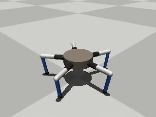

# Rocky Walker

An open-source, five-legged walking robot inspired by Rocky from *Project Hail Mary*.

Rocky Walker has five legs spread evenly around a round, rock-like carapace, and **no front**. It's meant to walk in any direction and turn in place, like the character. The brain is a Raspberry Pi 5 driving 15 cheap MG996R servos through a PCA9685 board. Every structural part is 3D printed in PLA and fits a 180 × 180 mm print bed. The goal is a robot that other people can actually afford to rebuild: about $200 in parts, not counting the Pi.

## Status

**M1 done: Rocky walks in simulation.** It walks in any direction and turns in place on 15 simulated MG996R servos, within the torque budget. See [build log #1](docs/build-log/2026-11-23-01-walking-in-sim.md).



Next up is **M2**: one real leg on the bench. Follow along in the [build log](docs/build-log/).

| Milestone | What | State |
|---|---|---|
| M0 | Repo skeleton | ✅ |
| M1 | Kinematics + simulated walking | ✅ |
| M2 | One leg on the bench | 🚧 |
| M3 | Stand up | — |
| M4 | Walk | — |
| M5 | Phone control + dances | — |
| M6 | Camera follow mode | — |
| M7 | Voice (Rocky speaks in chords) | — |

## Why

This project is open from day one. It's a public record of building a legged robot from scratch: the design decisions, the maths, what worked and especially what didn't. Read the [design doc](docs/design/2026-11-23-rocky-walker-design.md) for the full reasoning.

## Repo layout

```
README.md               what / why / status / photos / fan disclaimer
LICENSE                 software licence (MIT)
LICENSE-HARDWARE        hardware licence (CERN-OHL-P v2)
config/rocky.toml       single source of truth: geometry, servos, gait
cad/                    build123d parts + export script → STL/STEP   (from M2)
rocky/                  Python package: kinematics, gait, motion, backends, sim, ...
tools/                  calibration, servo test, etc.                (from M2)
tests/
docs/
  design/               design documents
  plans/                implementation plans
  build-log/            dated progress entries
  bom.md                parts list
```

## Development

The project needs [uv](https://docs.astral.sh/uv/).

```bash
uv sync
uv run pytest                                              # 51 tests, including MuJoCo walking
uv run python -m rocky.sim walk --vx 0.03 --vy 0.02        # walk and print a report
uv run python -m rocky.sim torque --gait star              # torque budget check
uv sync --extra video && uv run python -m rocky.sim walk --wz 0.25 --video out/turn.mp4
uv run mjpython -m rocky.sim walk --vx 0.03 --viewer       # interactive 3D viewer (macOS)
```

## Licences

- **Software** (everything under `rocky/`, `tools/`, `tests/`): [MIT](LICENSE).
- **Hardware** (CAD under `cad/`, generated models and hardware documentation): [CERN-OHL-P v2](LICENSE-HARDWARE).

## Disclaimer

> Rocky Walker is a fan-made project inspired by the character Rocky from Andy Weir's novel *Project Hail Mary*. It is not affiliated with or endorsed by Andy Weir, his publishers, or the film's producers. All designs, code and media in this repository are original.
