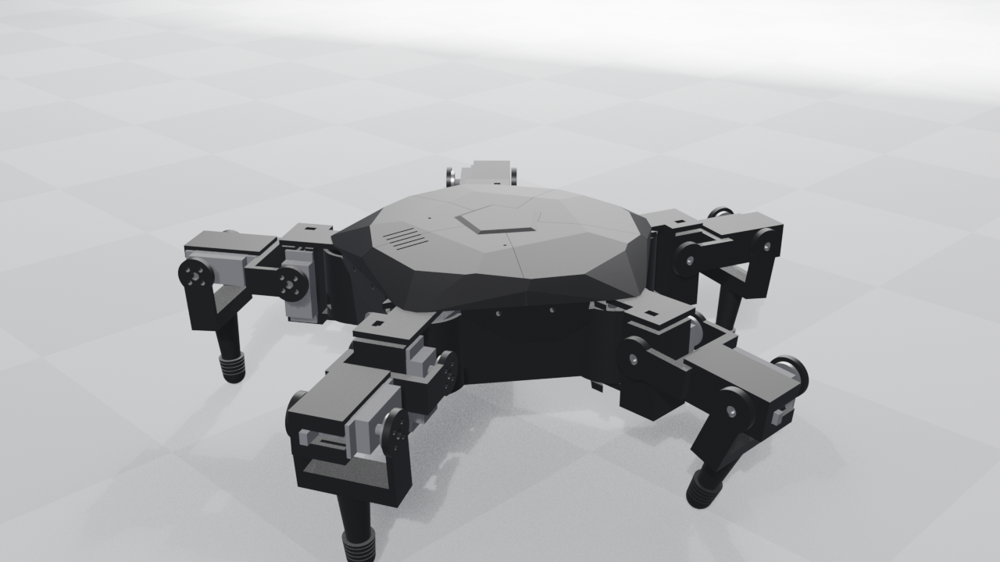
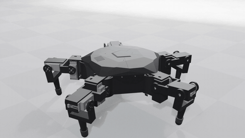
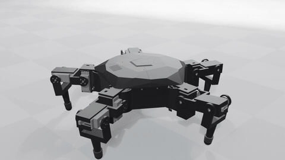
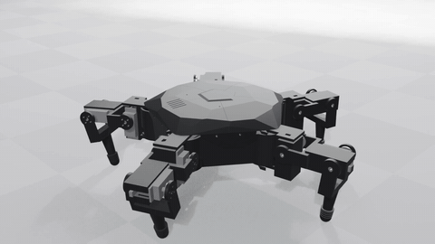
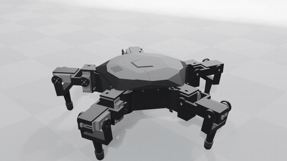
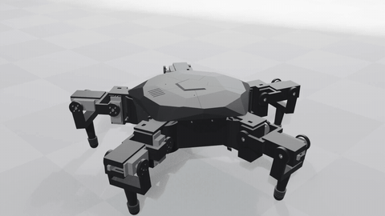
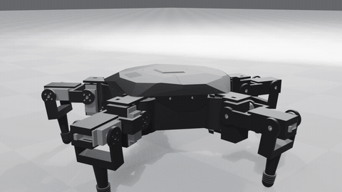
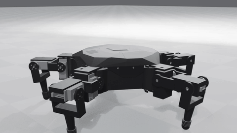

# Rocky Walker

An open-source, five-legged walking robot inspired by Rocky from *Project Hail Mary*.

Rocky Walker has five legs spread evenly around a round, rock-like carapace, and **no front**. It's meant to walk in any direction and turn in place, like the character. The brain is a Raspberry Pi 5 driving 15 cheap MG996R servos through a PCA9685 board. Every structural part is 3D printed (PLA or PETG) and fits a 180 × 180 mm print bed. The goal is a robot that other people can actually afford to rebuild: about **US $290** for everything, including a spare battery, the charger and the voice hardware, but not the Pi and camera. See the [component list](docs/bom.md).

## Status

**Parts are in and the first hip is printed.** Every servo has been bench-tested, the CAD is corrected to caliper measurements, the leg prints without supports, and the body is now wide and flat, all in black. See [build log #3](docs/build-log/2026-11-27-03-real-parts-and-wide-body.md).



*Render, not a photo: see the preview section below.*

Next up is finishing the **bench leg**: one printed leg on real servos. Follow along in the [build log](docs/build-log/).

| Milestone | What | State |
|---|---|---|
| M0 | Repo skeleton | ✅ |
| M1 | Kinematics + simulated walking | ✅ |
| M2 | Fusion 360 design + Blender showcase | ✅ |
| M2b | One leg on the bench | 🚧 |
| M3 | Stand up | — |
| M4 | Walk | — |
| M5 | Phone control + dances | — |
| M6 | Camera follow mode | — |
| M7 | Voice (Rocky speaks in chords) | — |

## What Rocky should be able to do (preview)

> ⚠️ **These are not real videos of the robot.** They're computer renders made in Blender from the Fusion 360 design. They show what Rocky is being built to do. The motion is real code, though: every frame comes from the same walking and dance software that will drive the physical servos, not from hand animation. Real footage will replace these once the hardware walks.

| Walk forward | Walk diagonally (no front!) |
|---|---|
|  |  |
| **Turn in place** | **Dance routine** |
|  |  |

| Ring ripple | Star step |
|---|---|
|  |  |
| **Rock mode** | **Rest mode** (before power-off or charging) |
|  |  |

Full-length render videos of the earlier, stacked design are on the [M2 release](https://github.com/sayedmowafi/rocky-walker/releases/tag/m2).

## Why

This project is open from day one. It's a public record of building a legged robot from scratch: the design decisions, the maths, what worked and especially what didn't. Read the [design doc](docs/design/2026-11-23-rocky-walker-design.md) for the full reasoning.

## Repo layout

```
README.md               what / why / status / photos / fan disclaimer
LICENSE                 software licence (MIT)
LICENSE-HARDWARE        hardware licence (CERN-OHL-P v2)
config/rocky.toml       single source of truth: geometry, servos, gait
cad/                    Fusion 360 design (.f3d) + STEP + STLs; build scripts in cad/fusion/
moves/                  dance moves (TOML keyframes)
showcase/               Blender scene script
rocky/                  Python package: kinematics, gait, motion, backends, sim, ...
tools/                  Fusion MCP client + script runner (calibration tools come with the bench leg)
tests/
docs/
  design/               design documents
  plans/                implementation plans
  build-log/            dated progress entries
  bom.md                parts list
```

## Development

The project needs [uv](https://docs.astral.sh/uv/).

```bash
uv sync
uv run pytest                                              # 120+ tests: kinematics, sim, CAD reports, moves
uv run python -m rocky.sim walk --vx 0.03 --vy 0.02        # walk and print a report
uv run python -m rocky.sim torque --gait star              # torque budget check
uv sync --extra video && uv run python -m rocky.sim walk --wz 0.25 --video out/turn.mp4
uv run mjpython -m rocky.sim walk --vx 0.03 --viewer       # interactive 3D viewer (macOS)
```

## Build one

Everything for printing is in [`cad/`](cad/):

- `cad/stl/`: one STL per printed part. Leg (×5): Coxa, Femur, Tibia, FootCap (TPU). Body (×1 each): ChassisTub_1–5, ChassisTop, BatteryHatch, Carapace_1–5, CarapaceRing, CarapaceCap, RockFace_1–5. All black. They're exported in assembly orientation, so use your slicer's "lay on face" to put each part flat. Every part fits a 180 mm bed.
- `cad/stl/plates/print1-hip/plate.3mf`: **print this first**: hip bracket + bench mount, support-free (see `docs/assembly/test-leg.md`).
- `cad/rocky.f3d` is the editable Fusion 360 source; `cad/rocky.step` opens in any CAD tool.
- Parts list: [docs/bom.md](docs/bom.md).

## Watch it in Blender

```bash
uv run python -m rocky.showcase export all out/anim/
/Applications/Blender.app/Contents/MacOS/Blender --background --factory-startup \
  --python showcase/build_scene.py -- --meshes cad/meshes --config config/rocky.toml \
  --anim out/anim/dance.json --out out/render/dance.mp4
```

See [showcase/README.md](showcase/README.md).

## Licences

- **Software** (everything under `rocky/`, `tools/`, `tests/`): [MIT](LICENSE).
- **Hardware** (CAD under `cad/`, generated models and hardware documentation): [CERN-OHL-P v2](LICENSE-HARDWARE).

## Disclaimer

> Rocky Walker is a fan-made project inspired by the character Rocky from Andy Weir's novel *Project Hail Mary*. It is not affiliated with or endorsed by Andy Weir, his publishers, or the film's producers. All designs, code and media in this repository are original.
