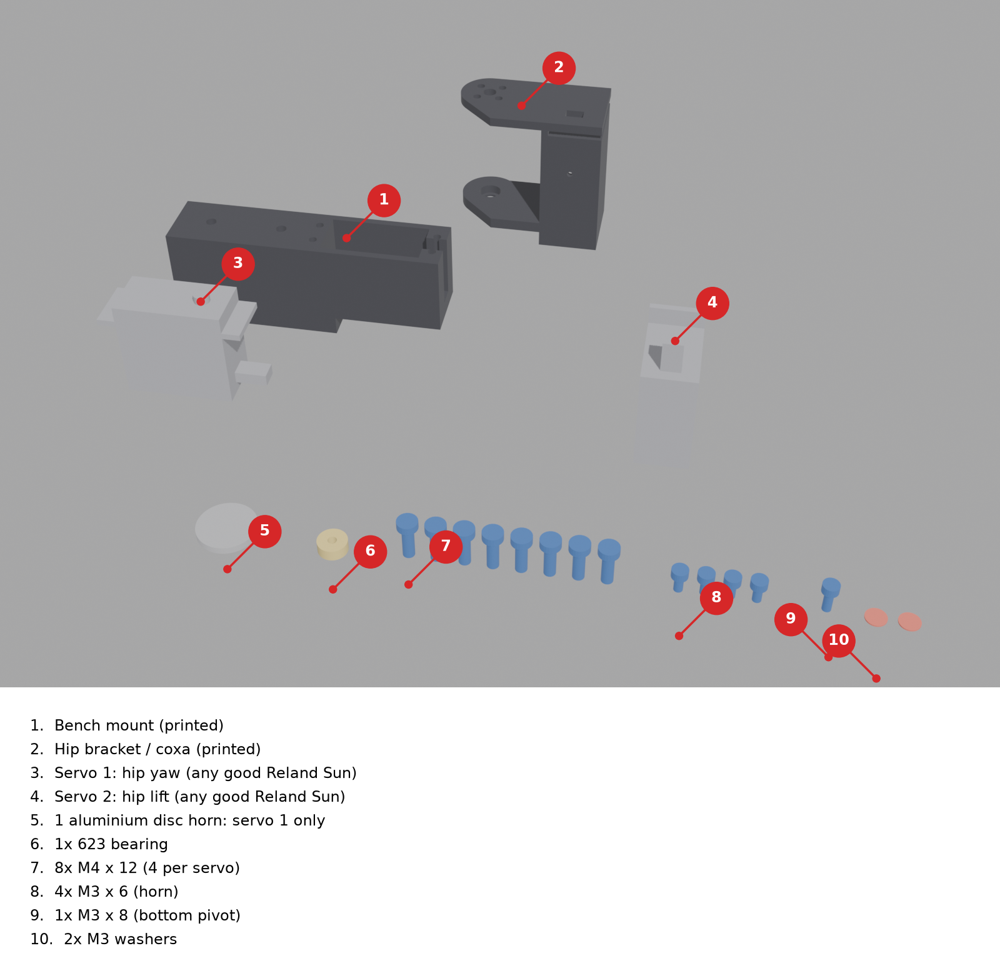
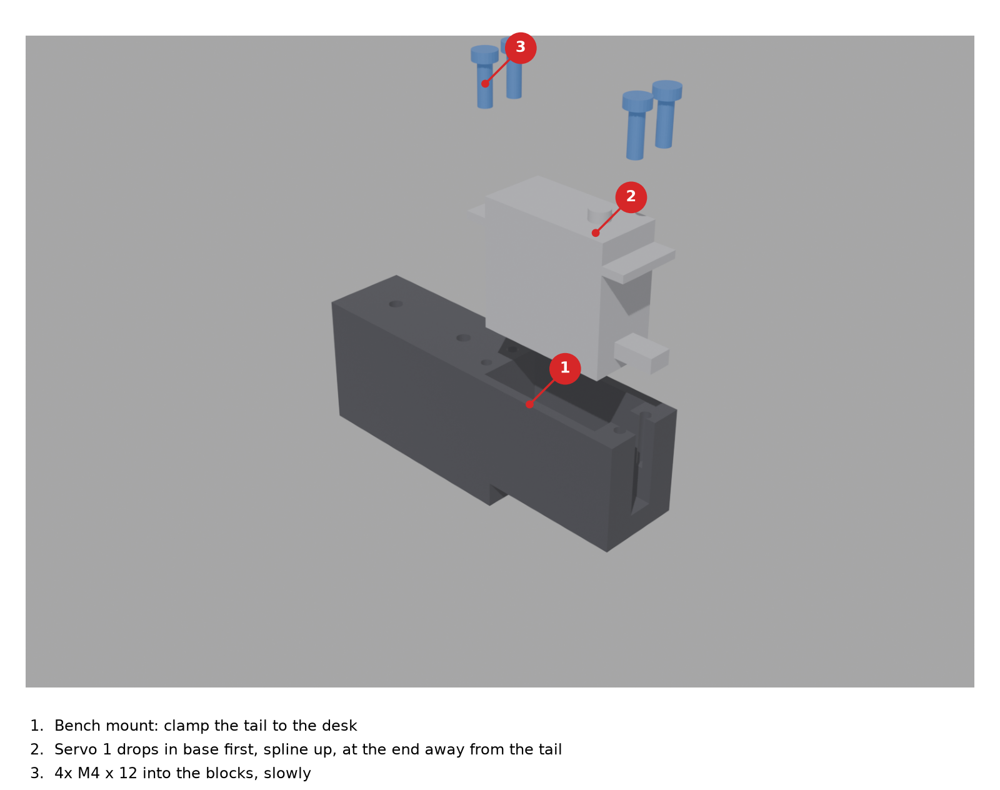
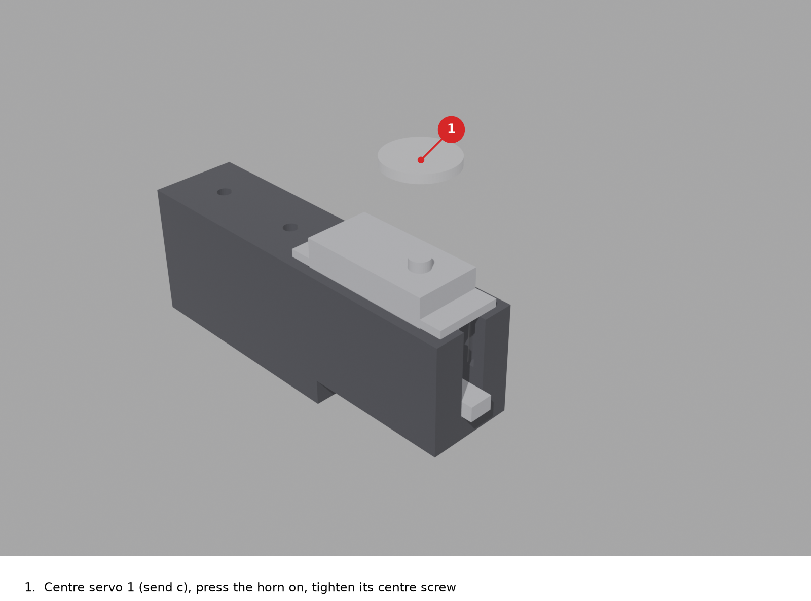
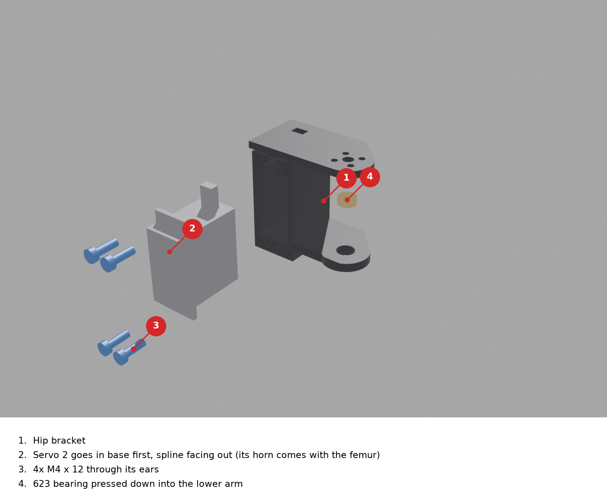
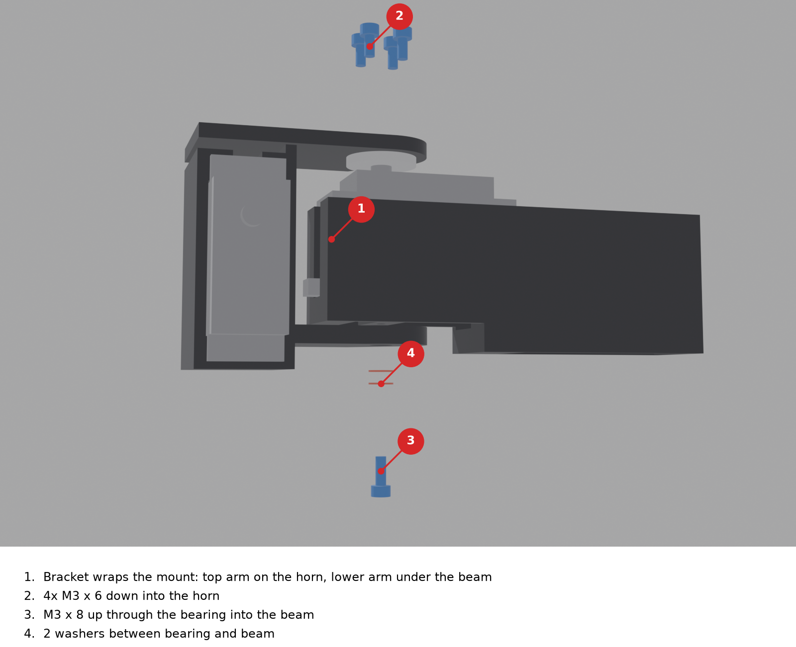
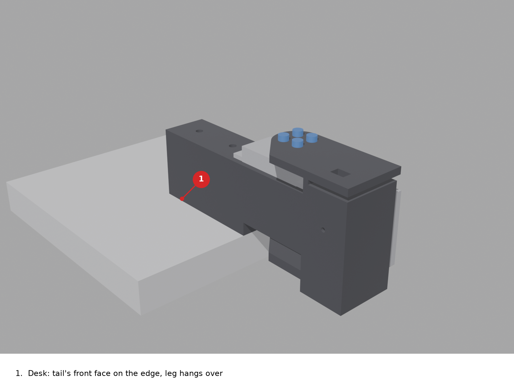

# Print 1: hip bracket + bench mount

Assembling the first print: the **bench mount** (stands in for the robot's body) and the **hip
bracket** (coxa). Takes about 20 minutes. Full leg guide: [test-leg.md](test-leg.md).

## What you need

| Item | Qty | Notes |
|---|---|---|
| Bench mount (printed) | 1 | |
| Hip bracket / coxa (printed) | 1 | |
| MG996R servo | **2** | Servo 1 = hip yaw (turns the leg left/right). Servo 2 = hip lift (raises the leg). Use two of the good Reland Sun servos (#1–#10) |
| Aluminium 25T disc horn | **1** | On servo 1 only. Servo 2 gets its horn later, when the femur goes on |
| M4 × 12 screw | 8 | 4 per servo, threaded straight into the plastic. No nuts |
| M3 × 6 screw | 4 | Top arm into the horn |
| M3 × 8 screw | 1 | Bottom pivot |
| M3 washer | 2 | Under the bearing at the bottom pivot |
| 623 bearing | 1 | Bottom pivot |
| ESP32 servo tester + UBEC (6 V) | | To centre servo 1 before fitting the horn |

**Don't use the plastic horns that came with the servos.** The leg bolts to the aluminium disc horn.

## Step 1: Hip-yaw servo into the bench mount

- Servo 1 goes in **base first, spline up**, at the end away from the long tail. Its cable comes
  out of the slot in that end wall.
- The ears sit flat on the two blocks.
- 4× M4 × 12 through the ears. Drive them in **slowly**, because they cut their own thread. Stop
  when the ear is snug; over-tightening strips the plastic.

## Step 2: Centre servo 1, then fit the horn

1. Plug servo 1 into the ESP32 tester and send `c`. It moves to centre (1500 µs) and holds.
2. While it holds, press the aluminium horn onto the spline. Fit it straight down; don't twist the
   servo.
3. Tighten the horn's centre screw (it comes with the horn).
4. Send `o` to let it go limp.

The leg will point straight out at this centre position.

## Step 3: Hip-lift servo + bearing into the hip bracket

- **Servo 2** goes into the bracket's pocket **base first, with the spline facing out** of the open
  side. No horn on it yet.
- Lead its cable out through the slot in the pocket's end wall, then up through the small square
  hole in the top arm. Lay it back along the top arm.
- 4× M4 × 12 through its ears, slowly.
- **623 bearing:** press it down into the hole in the **lower** arm, from the inside face, until it
  sits flat on the lip. Use thumb pressure or a vice. If it's very tight, warm the hole briefly with
  the hot-air gun on low.

## Step 4: Join the bracket to the mount

1. Put the 2 washers on the M3 × 8 screw, but don't fit it yet.
2. Slide the bracket onto the front of the mount:
   - the **top arm** goes over the aluminium horn;
   - the **lower arm** goes under the mount, below the beam across the pocket floor.
3. 4× M3 × 6 down through the top arm into the horn's threaded holes. Leg pointing straight out.
4. From underneath, push the M3 × 8 (with its 2 washers) up through the bearing. The washers end
   up between the bearing and the beam. Thread it into the hole in the beam. **Stop as soon as it's
   snug.**
5. Turn the bracket by hand, gently, because you're back-driving the servo. It should swing
   smoothly, with a small gap between the lower arm and the mount and nothing rubbing.

## Step 5: Clamp it to the desk

- Put the mount on the desk with the tail's **front end on the desk edge**. The bracket and
  servo 2 hang out past the edge.
- Clamp the tail's top plate with a C-clamp, or screw it to a board through the two holes.

## Test it

Power servo 1 from the tester (UBEC 6 V, 5 A fuse, ground shared with the ESP32):

1. `c`: the leg points straight out.
2. `1400`, then `1600`: small moves.
3. `1300`, then `1700`: about ±30°.
4. `1200`, then `1800`: about ±45°, the limit I checked for collisions. **Don't run `s` or `w`**:
   they go beyond that.
5. `o`: limp.

**Watch for:**
- buzzing while it's standing still, which means something is binding;
- the bracket lifting off the horn;
- the lower arm touching the mount.

Servo 2 has nothing to move yet. Just check it centres with `c`.

**Next:** print 2 is the femur, which bolts onto servo 2 with the second horn.
