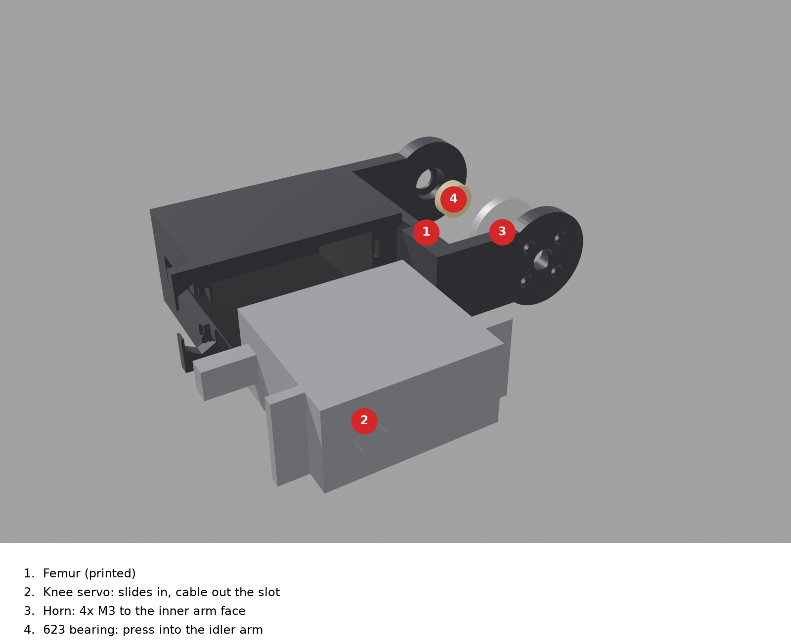

# Test leg: how it goes together

One bench leg: three printed parts, three servos, two idler bearings. On the bench, the hip-yaw
servo sits in the fit coupon. On the robot, it sits in the body. Print `cad/stl/plates/test-leg/plate.3mf`
(black PETG).

> Prints from before 2026-11-27 have the wrong horn hole spacing, no cable slots and no idler
> boss. Reprint all four parts.

## Hardware for one leg

| Part | Qty | Where |
|---|---|---|
| M4 × 10 screw + M4 hex nut | 12 | Servo ears, 4 per servo. The nut drops into the hex pocket under the ear plate |
| M3 × 6 screw (button or socket head) | 12 | Printed arm → aluminium horn, 4 per horn. The horn holes are threaded, so no nuts |
| M3 × 8 screw (button or socket head) | 2 | Idler pivots (hip-lift and knee). Self-taps into the cradle floor |
| 623ZZ bearing | 3 | Femur idler arm, tibia idler arm, coxa lower arm |
| 25T aluminium disc horn + its centre screw | 3 | One per servo |

Use M3 × 6 on the horns, nothing longer. The arm plate is 4 mm thick and the horn is 2.5 mm, so a
longer screw goes through the horn and hits the servo case.

## 0. Before you start

1. Centre every servo: connect it to the ESP32 tester and send `c` (1500 µs).
2. Push a horn onto each spline while the servo holds centre, then tighten the centre screw.
   Where the horn ends up rotationally doesn't matter: the printed arm sets the angle, and software
   calibration trims the last few degrees.
3. Check that every M4 nut drops into its hex pocket. If a pocket is tight, press the nut in with
   the screw and a few turns from the other side.

## 1. Hip bracket (Coxa)

1. **Hip-lift servo (2) into the cradle.** Spline side up into the open side. Lead the cable
   straight up through the slot in the shaft-end wall, then up through the slot in the top arm. Lay
   it back along the top arm toward the body. The first 8 mm past the case is stiff, and the slot
   takes that part straight.
2. Four M4 × 10 down through the ears, with nuts in the pockets underneath.
3. **Hip-yaw servo (3) into the fit coupon,** same way: 4× M4 + nuts.
4. **Coxa top arm onto the hip-yaw horn (4):** 4× M3 × 6 down through the top arm into the horn.
   Before tightening, the leg should point straight out with the servo at centre.
5. **623 bearing (5)** pressed into the lower arm. On the bench nothing goes through it yet. On the
   robot, the body's pivot bolt goes through it, opposite the hip-yaw spline.

## 2. Femur

1. **Knee servo (2) into the femur's cradle,** cable out through the slot in the shaft-end wall.
   4× M4 × 10 + nuts.
2. **623 bearing (4)** pressed into the idler arm (the arm without the four holes), from the inside
   face. It sits on a lip, and the outside face has a 6.6 mm recess for the screw head.
3. **Fit the femur's fork over the hip-lift servo** on the coxa bracket. The horn arm (3) goes on
   the horn side, and the bearing side goes against the round boss on the cradle floor. The fork
   slides on sideways; flex it slightly if it's tight.
4. 4× M3 × 6 through the horn arm into the horn. The femur should sit level with the servo at
   centre.
5. **Idler screw:** one M3 × 8 from the outside, into the head recess. It goes through the bearing
   and threads into the boss. Tighten until the head grips the bearing's inner ring, then stop:
   it's cutting threads in plastic. Swing the femur by hand; it should move freely with no rubbing.

## 3. Tibia

1. **623 bearing (3)** into the tibia's idler arm, same as the femur.
2. **Fork over the knee servo,** horn side (2) onto the horn, 4× M3 × 6. With the servo at centre,
   the tibia should hang about 80° below the femur line: mid-travel of the knee's −135° to −20°
   range.
3. **Idler screw:** M3 × 8 into the femur cradle's boss, same as above.
4. **TPU foot cap (4)** pushes on once you've printed it in TPU. Until then, run the bare tibia
   tip on the bench.

## 4. Done

**Cables:**
- The hip-lift lead exits on top of the coxa arm.
- The knee lead exits at the femur's shaft-end wall.
- Leave a loose loop at each joint so the full range doesn't pull on them.

**Power:** the three plugs go straight onto the PCA9685 for the bench test (see `docs/bom.md` §7).

## Why it's built this way

- **Horn holes:** the aluminium horn's M3 holes are on a **13.8 mm** circle, centre to centre.
  Caliper readings with the tips in the holes give edge-to-edge distances: 11.3 across and 7.3
  between neighbours. The threaded holes are about 2.5 mm, and 11.3 + 2.5 = 13.8. The printed
  holes are 3.6 mm because PETG holes print about 0.2 mm small.
- **Idler pivot:** the servo base sits directly behind the cradle floor, so there's no room for a
  nut. The screw self-taps into a 2.5 mm pilot through the floor and its 1 mm boss (4 mm of
  thread). The boss is exactly the arm-to-floor gap, so the screw clamps only the bearing's inner
  ring. Arm and floor never touch.
