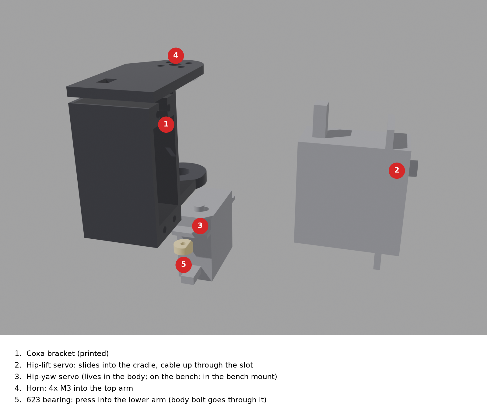
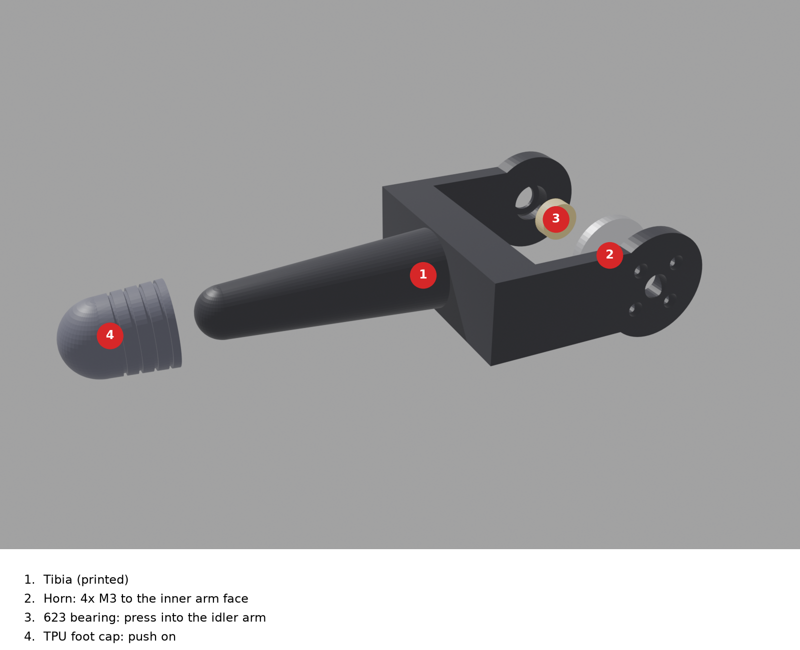
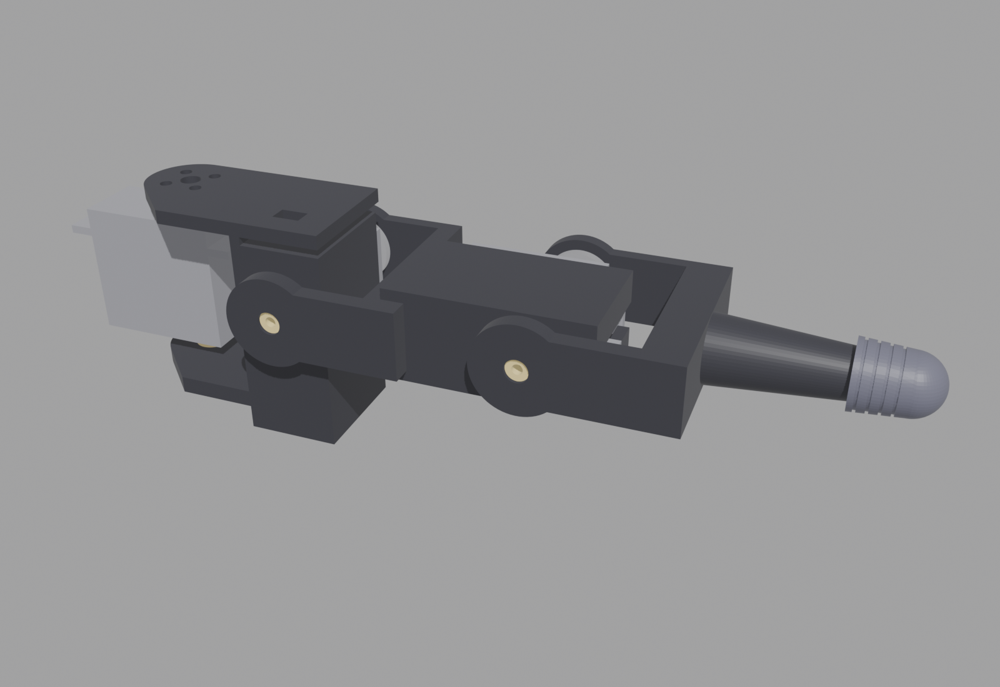

# Test leg: how it goes together

One bench leg: three printed leg parts plus a bench mount, three servos, and three 623 bearings.
On the robot, the hip-yaw servo sits in the body. On the bench it sits in the **bench mount**, which
holds the leg the same way the body will. Every part prints **with no supports** (PLA for test fits).

Print top to bottom, one plate at a time, and test each stage before printing the next:

| Print | File | Parts |
|---|---|---|
| 1 | `cad/stl/plates/print1-hip/plate.3mf` | Hip bracket (Coxa) + bench mount |
| 2 | femur plate (next) | Femur |
| 3 | tibia plate (next) | Tibia |

> Prints from before 2026-11-27 have the wrong horn hole spacing and need nuts. Don't mix them
> with these parts.

## Hardware for one leg

| Part | Qty | Where |
|---|---|---|
| M4 × 12 screw | 12 | Servo ears, 4 per servo. Self-taps into the 3.4 mm pilots in the printed ear blocks. No nuts |
| M3 × 6 screw (button or socket head) | 12 | Printed arm → aluminium horn, 4 per horn. The horn holes are threaded, so no nuts |
| M3 × 8 screw (button or socket head) | 3 | Pivots: coxa lower arm, femur idler, tibia idler. Self-taps into the cradle floor |
| M3 washer (0.5 mm) | 6 | Two under each pivot, between the bearing and the cradle floor |
| 623ZZ bearing | 3 | Coxa lower arm, femur idler arm, tibia idler arm |
| 25T aluminium disc horn + its centre screw | 3 | One per servo |

Use M3 × 6 on the horns, nothing longer. The arm plate is 4 mm thick and the horn is 2.5 mm, so a
longer screw goes through the horn and hits the servo case.

## Printing (PLA, no supports)

- 0.2 mm layers, 3 walls, 20–25 % gyroid infill, **supports off**.
- Load the 3MF as is: the parts are already oriented.
  - Hip bracket: cradle floor down.
  - Bench mount: upside down, with the servo pocket's opening on the plate.
- The only overhangs are hole tops and bridges of 20 mm or less, which PLA prints cleanly.
- Holes print slightly small. If a 623 bearing won't press in by hand, warm the pocket with the
  hot-air gun on low or sand it lightly. Don't hammer it.

## 0. Before you start

1. Centre every servo: connect it to the ESP32 tester and send `c` (1500 µs).
2. Push a horn onto each spline while the servo holds centre, then tighten the centre screw.
   Where the horn ends up rotationally doesn't matter: the printed arm sets the angle, and software
   calibration trims the last few degrees.

## 1. Hip bracket + bench mount (print 1)

1. **Hip-yaw servo (3) into the bench mount,** spline up and on the end away from the tail.
   4× M4 × 12 through the ears into the blocks. Drive them in slowly: they're cutting threads.
2. **Hip-lift servo (2) into the coxa's cradle.** Spline side first into the open side. Lead the
   cable through the slot in the shaft-end wall, then up through the slot in the top arm. Lay it
   back along the top arm toward the body. The first 8 mm past the case is stiff, and the slot
   takes that part straight. 4× M4 × 12.
3. **623 bearing (5)** pressed into the coxa's lower arm from the top face. It sits on a lip, and
   the underside has a recess for the screw head.
4. **Fit the coxa around the bench mount:**
   - the top arm goes over the hip-yaw horn (4);
   - the lower arm goes under the mount's floor, with **two M3 washers** between the bearing and
     the floor.
5. 4× M3 × 6 down through the top arm into the horn. The leg should point straight out with the
   servo at centre.
6. **Pivot screw:** one M3 × 8 up from below, through the head recess, the bearing and the washers,
   into the hole in the mount's floor. Tighten until the head grips the bearing's inner ring, then
   stop. Swing the coxa by hand: it should turn freely, with the arm not touching the floor.
7. **Clamp the tail** to the desk with a C-clamp, or two wood screws through its holes. Put the
   tail's front face (the end nearest the servo) on the desk edge, so the leg hangs over the edge.

## 2. Femur (print 2)

1. **Knee servo (2) into the femur's cradle,** cable out through the slot in the shaft-end wall.
   4× M4 × 12.
2. **623 bearing (4)** pressed into the idler arm (the arm without the four holes), from the inside
   face.
3. **Fit the femur's fork over the hip-lift servo** on the coxa. The horn arm (3) goes on the horn
   side; on the other side, two M3 washers go between the bearing and the cradle floor.
4. 4× M3 × 6 through the horn arm into the horn. The femur should sit level with the servo at
   centre.
5. **Idler screw:** M3 × 8 from the outside, through the bearing and the washers, into the cradle
   floor. Stop as soon as it grips.

## 3. Tibia (print 3)

1. **623 bearing (3)** into the tibia's idler arm, same as the femur.
2. **Fork over the knee servo,** horn side (2) onto the horn, 4× M3 × 6. With the servo at centre,
   the tibia should hang about 80° below the femur line: mid-travel of the knee's −135° to −20°
   range.
3. **Idler screw:** M3 × 8 + 2 washers into the femur cradle's floor, same as above.
4. **TPU foot cap (4)** pushes on once you've printed it in TPU. Until then, run the bare tibia
   tip on the bench.

## 4. Done

**Cables:**
- The hip-lift lead exits on top of the coxa arm.
- The knee lead exits at the femur's shaft-end wall.
- Leave a loose loop at each joint so the full range doesn't pull on them.

**Power:** the three plugs go straight onto the PCA9685 for the bench test (see `docs/bom.md` §7).

## Why it's built this way

- **Horn holes:** the aluminium horn's M3 holes are on a **13.8 mm** circle, centre to centre.
  Caliper readings with the tips in the holes give edge-to-edge distances: 11.3 across and 7.3
  between neighbours. The threaded holes are about 2.5 mm, and 11.3 + 2.5 = 13.8. The printed
  holes are 3.6 mm because plastic holes print about 0.2 mm small.
- **Pivots:** the servo base sits directly behind each cradle floor, so there's no room for a nut.
  The M3 × 8 self-taps into a 2.5 mm pilot through the 3 mm floor. Two 0.5 mm washers fill the
  1 mm gap, so the screw clamps only the bearing's inner ring, and the arm never rubs the floor.
- **No supports:** the servo ears sit on solid blocks that run down to the cradle floor, instead of
  a thin ledge, and the ear screws thread straight into them. A 45° web joins each coxa arm's
  round end to the bed side, so nothing on the parts prints in mid-air.
- **Bench mount:** without the bottom pivot, the whole leg would hang off the hip-yaw servo's
  shaft. The mount gives the bottom pivot something to bolt to, just like the body will.
