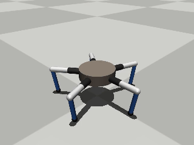
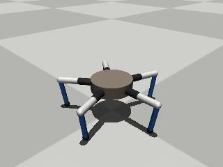
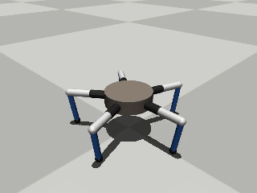

# Build log #1: Rocky walks (in simulation)

*2026-11-23 · Milestone M1*

Before printing anything, I wanted to know one thing: **can 15 cheap MG996R servos actually carry a five-legged, roughly 2 kg robot?** So Rocky's first steps happened in MuJoCo, a free physics simulator, driven by the exact same Python code that will drive the real servos later.

| Forward | Diagonal | Turn in place |
|---|---|---|
|  |  |  |

## What got built

- **One config file** ([`config/rocky.toml`](../../config/rocky.toml)) holds every dimension, limit and gait setting. The simulator model is *generated* from it, and so will the CAD be.
- **Leg inverse kinematics.** Each leg has 3 joints (hip yaw, hip lift, knee), solved analytically. It's tested by round-tripping every joint combination inside the joint limits.
- **Five legs, no front.** Legs sit at 72° steps around the body. Walking toward a leg, between two legs, sideways or at a random 197° heading all pass the same test.
- **Two gaits for five legs:**
  - **Wave:** one leg in the air at a time, so 4 feet are always down. The safe default.
  - **Star:** leg *i* starts its step at phase 2i/5, so legs lift in the order **0 → 3 → 1 → 4 → 2**. Two legs can be up at once, but never two neighbours. It's 33% faster.

  The usual hexapod "tripod" gait doesn't divide evenly across five legs, which is why Rocky needs its own.
- **Motion guards.** The command ramps at an acceleration limit, a joystick pushed too far is scaled down to the longest stride the legs can manage, joint limits are enforced, and joint speed is capped at what an MG996R can do. Letting go of the joystick mid-step lets the swinging feet finish and settle.
- **A sim CLI:** `uv run python -m rocky.sim walk --vx 0.03 --video out/walk.mp4`, and `... torque --gait star` for a torque report.

## The question: are MG996Rs strong enough?

My rule is that **sustained torque on any joint (0.5 s average) must stay at or below 0.49 N·m (5 kg·cm)**. That's about half of an MG996R's stall torque at 6 V, leaving room for cheap-clone variation.

In the sim, the servos are torque-limited to MG996R stall, so the sim can't cheat.

**First result, at the starting geometry (stance radius 180 mm):** it passes, but only just.

| Robot mass | Wave | Star |
|---|---|---|
| 2.0 kg (estimate) | 89% of the limit | 98% |
| 2.2 kg | 99% | 109% ❌ |
| 2.4 kg | 109% ❌ | 120% ❌ |

My mass estimate is 1.8–2.1 kg, and real builds always come out heavier, so 10% margin wasn't enough to print against. The hip-lift (femur) servo does almost all the work. Its load is the robot's weight times the horizontal distance from the hip joint to the foot.

**The fix: shrink before upgrading.** I brought the feet 15 mm closer to the body (stance radius 180 → **165 mm**). That cuts the femur lever from 70 mm to 55 mm.

| Robot mass | Wave | Star |
|---|---|---|
| 2.0 kg | 74% | 79% |
| 2.2 kg | 82% | 88% |
| 2.4 kg | 90% | 96% |

Both gaits now pass even if Rocky comes out 20% heavier than estimated. Walking accuracy and tilt didn't change measurably (tilt stays under 1°).

## Frozen values (M1)

| | |
|---|---|
| Coxa / femur / tibia | **40 / 70 / 100 mm** |
| Body centre → hip (mount radius) | 70 mm |
| Stance radius (body centre → foot) | **165 mm** (≈ 33 cm foot-to-foot) |
| Body height (hip joints above ground) | 100 mm |
| Step height | 30 mm |
| Max stride | 60 mm |
| Gait period | 1.5 s (wave duty 0.8, star duty 0.6) |
| Top speed | wave 5 cm/s, star 6.7 cm/s |

Torque at 80% of top speed, 2.0 kg, worst leg:

| Joint | Wave (sustained) | Star (sustained) |
|---|---|---|
| Coxa (hip yaw) | 0.054 N·m | 0.054 N·m |
| Femur (hip lift) | 0.362 N·m | 0.388 N·m |
| Tibia (knee) | 0.193 N·m | 0.276 N·m |

## What didn't go perfectly

- **The star gait briefly hits stall torque at touchdown.** The sustained average is fine (79%), but the instantaneous peaks reach 1.08 N·m, the MG996R's stall limit, for a few milliseconds as feet land. Wave peaks at about 0.9 N·m. Wave stays the default, and softening touchdown is on the list for the real robot.
- **Rocky walks about 5% further than commanded.** Feet start from neutral rather than mid-stride, so the first steps add a little extra. It's harmless, but it will matter for follow mode later.
- **Floating-point maths nearly broke the gait.** `0.6 − 0.2` isn't exactly `0.4` in floating point, and at exact phase boundaries that briefly put two neighbouring legs in the air together. The tests caught it, and phases are now rounded at the boundaries.
- **The simulator is optimistic.** It has perfect servos with no gear slop or deadband, rigid parts and an even floor. The real MG996Rs will be worse, which is exactly why I wanted the margin.

## Next: M2, one leg on the bench

Print one leg, wire 3 MG996Rs through a PCA9685, write the servo calibration tool, and make the real foot trace a circle smoothly. That means designing the leg in build123d, from this same config file.
