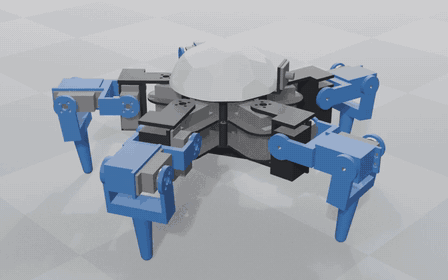
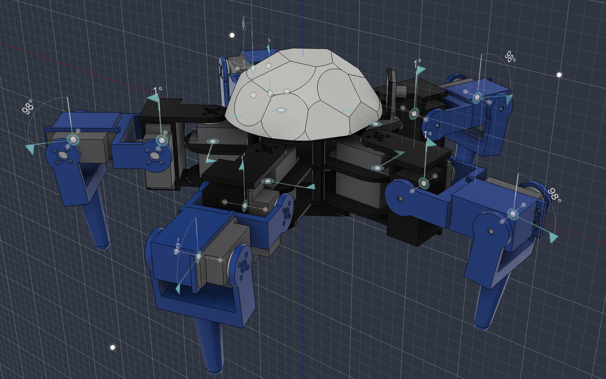
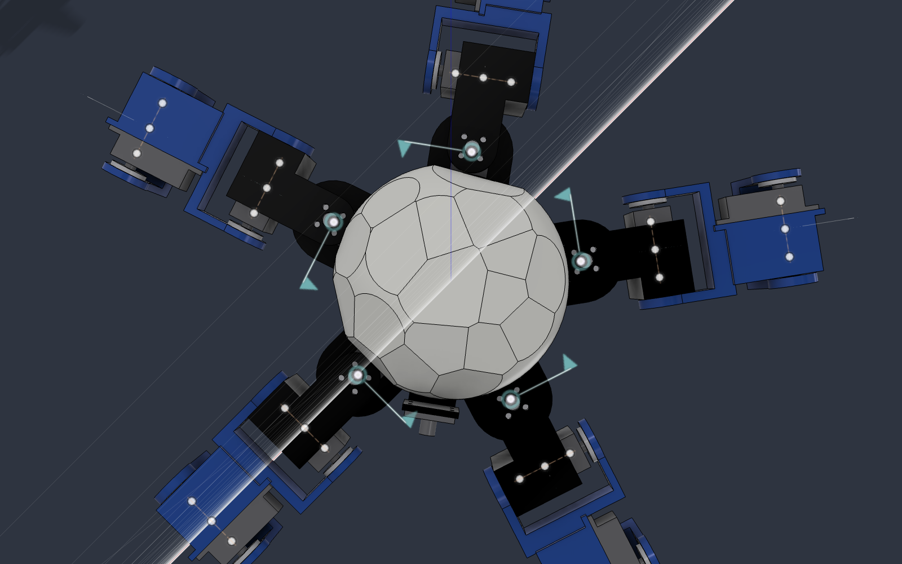
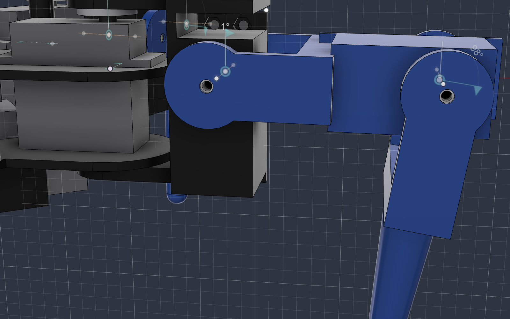
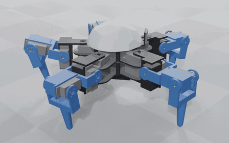
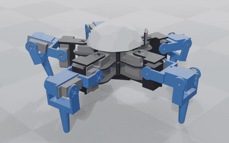
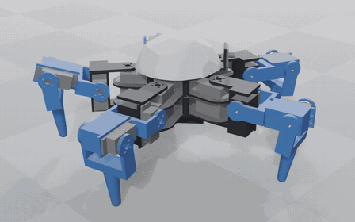

# Build log #2: Rocky gets a body (Fusion 360 + Blender)

*2026-11-23 · Milestone M2*

M1 proved, in simulation, that cheap MG996R servos can carry a five-legged Rocky. M2 turned the stick figure into a real, printable design in **Fusion 360**, then rendered the assembled robot in **Blender**. It walks and dances there, driven by the **same motion code** that will run on the robot.

## The design (Fusion 360)

| Assembled | Top view | One leg |
|---|---|---|
|  |  |  |

**How it was built:** every part was built by a script through Fusion's MCP connection, so you can see how each one was made in [`cad/fusion/`](../../cad/fusion/). The key dimensions are Fusion parameters with the same names as `config/rocky.toml`, so the CAD and the code can't silently drift apart. A test compares them.

**Each leg** (three MG996Rs):
- **Coxa bracket:** wraps the hip-yaw servo, bolted to its horn on top, with a 623 bearing pivot underneath. It carries the hip-lift servo in a cradle.
- **Femur:** a U-bracket, horn on one side and bearing on the other. A bridge carries the knee servo in a second cradle.
- **Tibia:** a U-bracket at the knee, tapering to a rounded foot.
- **Every joint is supported on both sides.** The servo spline isn't asked to take side loads alone, which is the classic way cheap servos die.
- **Servo ears screw into captive M3 nuts,** so there are no heat-set inserts and no special tools.

**The body:**
- **Two lobed chassis plates** sandwich the five hip servos at 72°.
- **Between the plates:** the PCA9685 and both voltage regulators.
- **Underneath:** a strapped battery tray.
- **On top:** a deck for the Pi 5 and the camera.
- **Over the deck:** a faceted, rock-like carapace, printed in one piece.

**Print:** every printed part fits a 180 mm bed. There's also a small **fit coupon** with one servo pocket, one bearing seat and one horn pattern. Print it first to tune the clearance for your printer and your servos.

## What the CAD changed

Putting real parts together found things the stick-figure sim couldn't. Each change went back into the config, followed by a full re-test ([details](../../cad/reports/changes.md)):

| What | Was | Now | Why |
|---|---|---|---|
| Hip-lift range | −60° … +90° | **−40° … +40°** | Past ±40° the femur or knee servo hits the hip bracket |
| Knee range | −150° … −20° | **−135° … −20°** | Folding further crashes the tibia into the femur |
| Battery | 3000–5000 mAh | **2200 mAh shorty** (73 × 34 × 18.5 mm, 98 g) | A bigger pack hits the legs' bottom arms |
| Camera | on a carapace facet | **on a tab at the deck edge** | A dome curves away under any flat circuit board |
| Total mass | 2.0 kg (estimate) | **1.69 kg** (measured) | Real part volumes, with printed parts at 60% of solid PLA |

Walking never used the range I removed. The full-speed walking-envelope check and every walking test still pass.

**Lighter is better here.** With the real masses and each leg segment's real balance point (the knee servo sits out at the knee, which matters), the hip-lift servos now need:

| Gait | M1 (estimated mass) | M2 (measured) |
|---|---|---|
| Wave (default) | 73% of the torque budget | **59%** |
| Star (fast) | 90% | **70%** |
| Dance routine | — | **56%** |

## Walking and dancing in Blender

| Forward | Diagonal | Turn in place |
|---|---|---|
|  |  |  |

**This isn't hand animation.** Each frame comes from running the real `MotionController` (walking) or the new move player (dancing). It produces 15 joint angles plus where the body is, and a Blender script keyframes the Fusion meshes with those values. A test checks that a foot on the floor never slides more than 1 mm between frames. It's 0.4 mm walking and 0 mm dancing.

*(These clips were rendered just before I resized the battery tray for the real pack, so the battery under the body is the older, longer placeholder. The CAD and meshes in the repo have the final 73 mm pack.)*

**The dance** is five moves chained into a 21-second routine: sway, bob, twist, tilt-circle and a leg wave. Moves are plain [TOML files](../../moves/), so anyone can write one. Before the robot will play a move, it has to pass four checks:
1. **Reach:** every foot position is reachable.
2. **Limits:** every joint stays inside its physical limits.
3. **Speed:** no joint is asked to move faster than an MG996R can.
4. **Balance:** the centre of mass stays at least 15 mm inside the feet that are on the floor. For the leg wave, Rocky first shifts its body away from the leg it's about to lift.

The whole routine also runs in the MuJoCo physics sim against the torque budget.

## What went wrong

- **I started in the wrong tool.** I pushed code-CAD (build123d) when the plan was always to use Fusion. We switched before any CAD existed, so nothing was lost but a conversation.
- **Four of the five legs were floating in space.** Fusion placed the copied legs at *twice* the mount radius. My "all five legs, no collisions" check passed because four legs weren't touching anything. A top-down screenshot gave it away. The legs are now placed explicitly and locked to the body, and a test checks every leg's position.
- **The first carapace had holes.** I cut the facets into the outside before hollowing it, so deep facets punched through the 2.4 mm wall. Now the inside gets the same facets, offset by the wall thickness.
- **Copy-paste geometry bugs:** a knee cradle computed from the wrong end of the servo, and mounting ears overlapping brackets. An automatic collision report caught both before any print.

## Next: the bench leg

Print one leg and the fit coupon, wire three MG996Rs through a PCA9685, write the servo driver and calibration tool, and make a real foot trace a circle smoothly.
