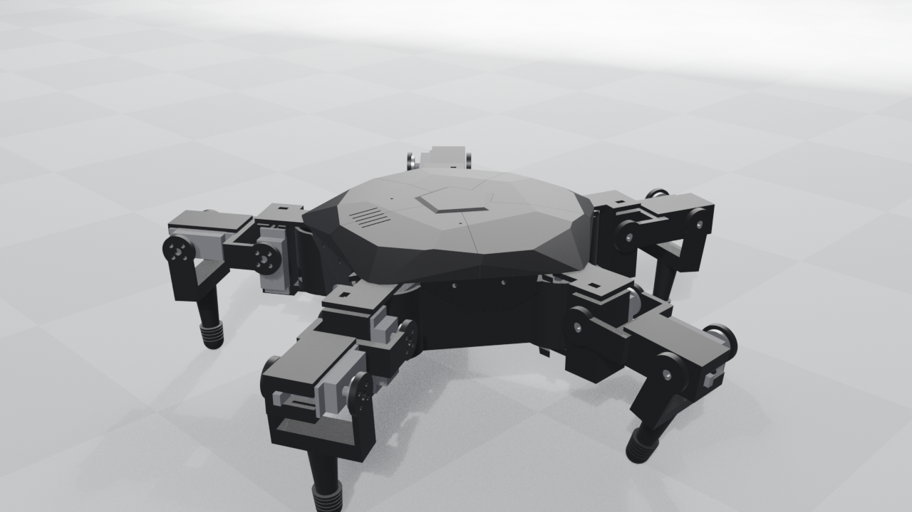
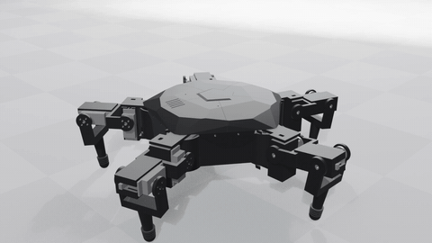
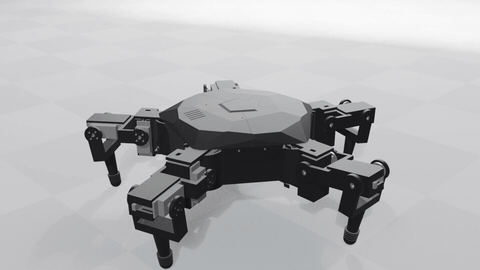
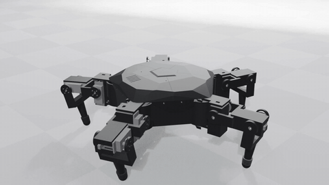
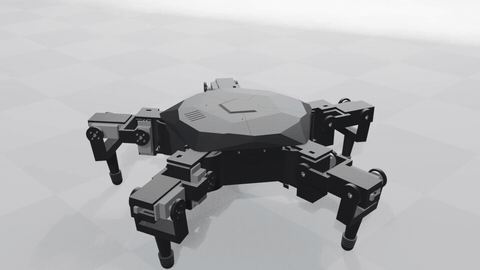
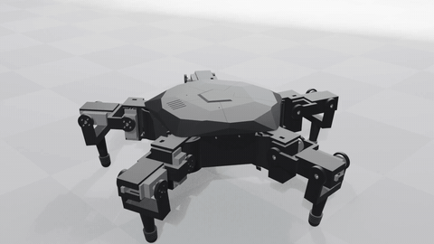
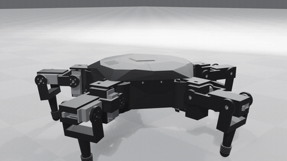
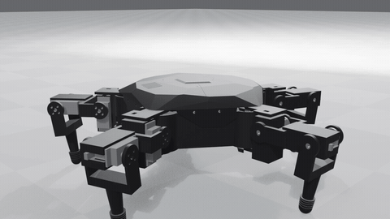

# Build log #3: real parts, a printed hip, and the wide body

*2026-11-27 · Milestone M2b (one leg on the bench), in progress*

*Render, not a photo.*

The parts arrived. This stretch was about meeting reality: testing every servo, measuring the real
parts, printing the first hip, and redesigning the body to be wide and flat.

## Servo testing

Every servo was swept on an ESP32 bench tester before it got anywhere near the robot
([log](../servo-test-log.md)):

- **10 of 10 Reland Sun** were good.
- **All 4 Beffkkip** jammed at the same spot and went back.
- **1 Besomi** was good.

That leaves 11 good servos out of the 15 needed.

## The CAD meets the calipers

The first prints didn't fit. Every miss went back into the Fusion parameters
([measurements](../../cad/reports/measurements.md)):

| What | CAD assumed | Real | Fix |
|---|---|---|---|
| Horn bolt circle | 14 mm, then 11.3 | **13.8 mm** centre to centre | 11.3 was an edge-to-edge reading |
| Horn height | disc flush with the spline (44.2 mm above the servo base) | **47.0 mm** | The disc sits on a hub; every printed arm moves out 2.8 mm |
| Servo ear height | 30.0 mm (online STEP model) | **28.4 mm** | The servo hung 1.7 mm high in its pocket |
| Servo cable exit | not modelled | 7.2 × 4.6 mm, stiff for 8 mm | Every pocket gets an open-topped slot for it |
| Ear screw pilot | 3.4 mm | **3.7 mm** | M4 wouldn't thread into PLA by hand |

## Printable without supports

Every leg part was reworked to print flat with **no supports**:
- solid blocks under the servo ears, with the M4 screws threading straight into them;
- washers instead of printed bosses at the pivots;
- a 45° strut under each round arm end.

A new **bench mount** holds the hip-yaw servo exactly the way the body will. The leg hangs between
the horn (top) and a bearing pivot (bottom) instead of off the servo shaft. The first hip bracket
and bench mount are printed in PLA. Assembly guide:
[print1-hip.md](../assembly/print1-hip.md).

## The wide, single-layer body

The stacked body looked too tall, so the body is now wide and flat. It's a single chassis level:
- **Chassis:** a five-piece tub with the hip servos at 72°.
- **Top plate:** carries the Pi.
- **Carapace:** a low faceted rock, with a rock face over each flank.

**Everything printed is black.** Body and legs are clear of each other at the standing pose and at
full hip yaw. All 132 tests pass again.

> ⚠️ **These are renders, not videos of the robot.** The motion comes from the real walking and
> dance code that will drive the servos.

| Walk forward | Walk diagonally |
|---|---|
|  |  |
| **Turn in place** | **Dance** |
|  |  |

## Moves only a five-legged robot can do

Four new moves lean on what makes Rocky different: five legs, no front, a rock for a shell.
They're generated by [`tools/make_moves.py`](../../tools/make_moves.py) and pass the same checks
the servos will run under:
- joint limits;
- servo speed;
- centre of mass at least 15 mm inside the planted feet;
- no planted foot sliding.

**Only one leg ever lifts at a time.** With five legs, lifting two neighbours together leaves the
body outside the other three.

| Ring ripple | Star step |
|---|---|
|  |  |
| Each leg lifts in turn around the ring, both ways, then a twist | Legs step in pentagram order (0, 2, 4, 1, 3), reaching for each star point |
| **Rock mode** | **Rest mode** |
|  |  |
| Feet step out, the body flattens like a rock, shivers, stands | Sits on the hip brackets' lower arms before power-off or charging, so it can't tip; then wakes and stands |

**Rest mode** will become a real command: run it before switching off, and stand up from it at
power-on.

## Next

1. Finish the hip on the bench: centre, sweep ±45°.
2. Make the femur and tibia support-free, then print them for a full bench leg.
3. Write the PCA9685 backend and calibration, so the leg runs from the Pi instead of the ESP32
   tester.
